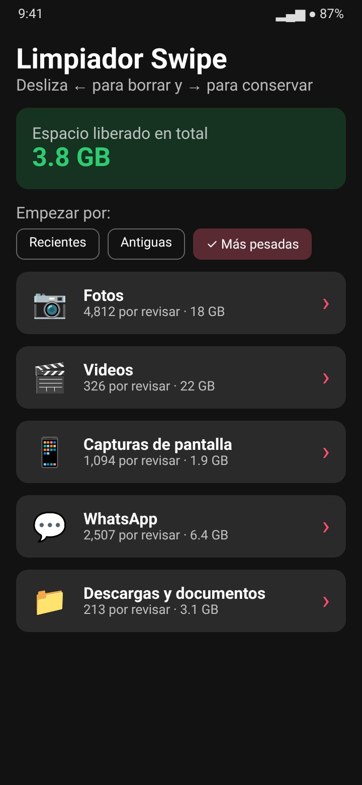
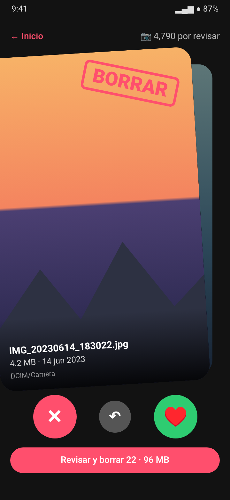
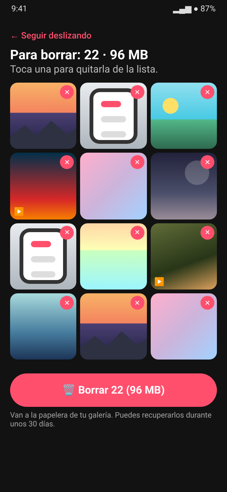

# Limpiador Swipe

Tenía el celular lleno: miles de fotos repetidas, capturas de pantalla que tomé una vez y nunca volví a ver, videos de WhatsApp de grupos que ni leo y una carpeta de descargas que ya daba miedo abrir. Borrar todo eso desde la galería, una por una, es tan aburrido que nunca lo hacía.

Así que hice esta app. La idea es simple: te muestra tus fotos y archivos de uno en uno, como en Tinder. **Deslizas a la izquierda para borrar y a la derecha para conservar.** Así limpiar se vuelve hasta entretenido, y en unos minutos puedes liberar varios gigas.

  
  &nbsp;
  
  &nbsp;
  

## Qué puedes limpiar

- **Fotos:** toda la galería.
- **Videos:** suelen ser lo que más espacio ocupa.
- **Capturas de pantalla:** separadas del resto, porque casi siempre se pueden ir.
- **WhatsApp:** las fotos y videos que te mandan por chats y grupos.
- **Descargas y documentos:** PDFs, APKs, archivos ZIP y todo lo que se va juntando.

## Cómo funciona

Eliges una categoría y empiezas a deslizar. Si te equivocas, el botón ↶ deshace la última decisión. También puedes tocar un video para verlo antes de decidir.

Nada se borra mientras deslizas. Lo que mandas a la izquierda se va juntando, y cuando quieras (o al terminar) ves todo en una cuadrícula para revisarlo con calma. Si ahí te arrepientes de alguna, la tocas y sale de la lista.

Las fotos y los videos no se borran para siempre: se van a la papelera de tu galería y los puedes recuperar durante unos 30 días. Los archivos de descargas sí se borran definitivamente, por eso la app te pide confirmar antes.

Un par de detalles que ayudan bastante:

- Puedes empezar por lo más reciente, por lo más antiguo o **por lo más pesado**. Esta última opción es la mejor si lo que quieres es liberar espacio rápido.
- Lo que decides conservar ya no te vuelve a aparecer la próxima vez. Si quieres revisar todo de nuevo, en la pantalla de inicio hay un botón para reiniciar.
- La app lleva la cuenta de cuánto espacio has liberado en total.

La app no usa internet. Tus fotos nunca salen de tu teléfono.

## Instalarla

Necesitas Android 11 o más nuevo.

1. Desde el celular, descarga el APK aquí: **[LimpiadorSwipe.apk](https://github.com/carolgallegos/LimpiadorSwipe/releases/latest/download/LimpiadorSwipe.apk)**
2. Ábrelo. Si Android te dice que no puede instalar apps de esa fuente, entra a **Ajustes**, activa **Permitir de esta fuente** y regresa.
3. Toca **Instalar**. Si aparece un aviso de Play Protect, elige **Instalar de todas formas**. Sale porque la app no viene de la Play Store.
4. Cuando la abras, dale permiso a tus fotos y videos con **"Permitir todo"**.

Para limpiar descargas y documentos, la app te pide además el permiso de "acceso a todos los archivos" y te lleva directo al ajuste.

## Para quien quiera ver el código

Está hecha en Kotlin con Jetpack Compose. Las fotos y videos se leen con MediaStore, y para borrarlas se usa la papelera del sistema (`MediaStore.createTrashRequest`). Las miniaturas se cargan con Coil.

Cada vez que se sube un cambio a `main`, GitHub Actions compila el APK y lo publica en [Releases](https://github.com/carolgallegos/LimpiadorSwipe/releases). Si prefieres compilarla tú, abre la carpeta en Android Studio y dale a Run.
